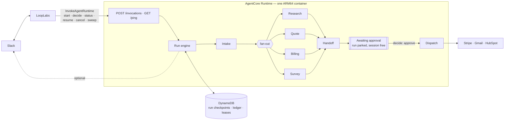

# customer-ops-agents

Parallel Claude agents for customer operations, packaged as **one agent on
Amazon Bedrock AgentCore Runtime** and controlled through a small JSON command
API, so an external control plane such as LoopLabs can start runs, approve
them, and watch them.

```json
{ "action": "start", "runId": "slack-Ev0123", "requestText": "Quote 20 Pro seats + onboarding for dana@acme.com, 10% off. Check billing and send a survey.", "requestedBy": { "userId": "U123" } }
```

| Agent | What it does | Writes |
|---|---|---|
| **Intake** (router) | Classifies the request, extracts the customer, decides which agents to run | HubSpot contact (create-or-get) |
| **Research** | Tool-using agent: HubSpot deals, recent Gmail threads, web search → account brief | — (read-only) |
| **Quote** | Maps requested items to the Stripe price catalog, prices in code, drafts a quote | Stripe customer + **draft** quote, HubSpot deal |
| **Billing** | Invoices/subscriptions → health, outstanding balance, suggested actions | — (read-only, can't move money) |
| **Survey** | Drafts a short CSAT/NPS survey, respecting a per-customer cooldown | — |
| **Customer handoff** | Merges all results (including failures) into an owner handoff + customer email | HubSpot note |
| **Dispatch** (after approval) | Finalizes the quote, emails the customer, sends the survey, creates the owner task | Stripe, Gmail, HubSpot |

## Architecture



There's no Step Functions, Lambda or API Gateway: the orchestration lives in
`src/workflow/engine.ts`, inside the agent.

### Why a durable engine inside the agent

AgentCore sessions end after **15 minutes idle** and live at most **8 hours**,
and a human approval can take a day. So a run is never tied to a session:

- Each run is one DynamoDB item. Every step's output is **checkpointed** before
  the run moves to the next phase:
  `RECEIVED → INTAKE_DONE → AGENTS_DONE → AWAITING_APPROVAL → APPROVED → DONE`
  (or `REJECTED` / `EXPIRED` / `FAILED` / `CANCELLED`).
- The container driving a run holds a **lease** on it with a heartbeat, and
  every checkpoint is conditional on still holding it (**fencing**). If a session
  dies mid-run, `resume` or `sweep` in any container continues from the last
  checkpoint, and the stalled container can't overwrite the newer state if it wakes up.
- At approval the run **parks** and the session goes idle. `decide` picks it
  up later in whatever container receives the call.
- While a run is executing in the background, `/ping` answers `HealthyBusy` so
  AgentCore keeps the session alive; it answers `Healthy` once work parks.

## Command API (POST /invocations)

| Command | Fields | Returns |
|---|---|---|
| `start` | `runId?` (idempotency key, e.g. Slack `event_id`), `requestText`, `requestedBy {userId, userName?}`, `slack? {channel, threadTs}`, `wait?` | Run view. Repeating a `runId` returns the existing run with `duplicate: true` |
| `decide` | `runId`, `decision: approve\|reject`, `userId`, `wait?` | `outcome`: `recorded`, `already_decided`, `expired`, `forbidden`, `closed`, `not_ready`, `not_found` |
| `status` | `runId` | Phase, agent statuses, approval prompt and expiry, dispatch results, **event log** |
| `resume` | `runId`, `wait?` | Continues a stalled or interrupted run from its last checkpoint |
| `cancel` | `runId`, `userId` | `cancelled` (if waiting for approval), `cancelling` (mid-flight), `not_cancellable` |
| `sweep` | `limit?` | Expires overdue approvals and resumes stalled runs. Call it every ~5 minutes |

`wait: true` makes the call block until the run parks or finishes (well
within AgentCore's 15-minute synchronous limit). Without it, the call returns
immediately and the run continues in the background.

Bad input gets a `400` with readable `issues`; there are no silent failures.

### Calling it from LoopLabs

Anything that can call AgentCore's `InvokeAgentRuntime` works. With the AWS SDK for JavaScript:

```ts
import { BedrockAgentCoreClient, InvokeAgentRuntimeCommand } from "@aws-sdk/client-bedrock-agentcore";

const client = new BedrockAgentCoreClient({ region: "us-east-1" });
const res = await client.send(
  new InvokeAgentRuntimeCommand({
    agentRuntimeArn: process.env.AGENT_RUNTIME_ARN, // stack output
    runtimeSessionId: `customer-ops-${crypto.randomUUID()}`, // any session works: state lives in DynamoDB
    contentType: "application/json",
    payload: new TextEncoder().encode(JSON.stringify({ action: "status", runId: "slack-Ev0123" })),
  }),
);
console.log(JSON.parse(await res.response!.transformToString()));
```

### Mapping Slack through LoopLabs

LoopLabs owns the Slack app (signature verification, the 3-second ack, retries). Map:

| Slack | Command |
|---|---|
| `/ops <text>` or `@mention` | `start` with `runId` = the event/trigger id (makes Slack retries harmless), `requestText`, `requestedBy`, and `slack {channel, threadTs}` if the agent should post into the thread |
| Button `approve` / `reject` (value = runId) | `decide` with the clicking user's id |
| Showing progress | `status` → `events[]`, `approval.prompt`, `dispatch[]` |

If you set `SLACK_BOT_TOKEN`, the agent also posts progress and the
Approve/Reject card into the thread itself. Leave it out and LoopLabs renders
everything from `status`.

## Errors and race conditions — how each is handled

| Scenario | What would go wrong | Mitigation | Where |
|---|---|---|---|
| Trigger retried / `start` sent twice | Duplicate runs | `start` is a conditional create on `runId`; duplicates return the existing run | `engine.ts` |
| AgentCore session dies mid-run (idle timeout, 8 h cap, deploy, crash) | Run lost or half done | Per-step checkpoints; lease expires; `resume`/`sweep` continues from the last checkpoint, agents that finished aren't re-run | `engine.ts` |
| Two containers drive the same run | Conflicting writes | Lease on the run item + every checkpoint fenced on `owner` | `engine.ts` |
| Step retried after a partial side effect | Duplicate emails, quotes, tasks | Every side effect runs through `once(key)` (DynamoDB ledger); Stripe also gets native idempotency keys | `idempotency.ts` |
| Crash after Gmail accepted, before ledger write | Email sent twice | Deterministic `Message-ID`; Sent folder checked before re-sending | `gmail.ts` |
| Two runs create the same Stripe customer | Duplicates | Per-email lease + strongly consistent `customers.list` + idempotency key | `quote.ts`, `lease.ts` |
| Two runs create the same HubSpot contact | Duplicates | HubSpot unique email → `409 Existing ID` is adopted | `hubspot.ts` |
| Two approvers click at once / double-click | Conflicting decisions | One conditional `AWAITING_APPROVAL → APPROVED/REJECTED` update wins; others get `already_decided` | `engine.ts` |
| Click races the 24 h window | Approve after expiry | Decision requires `approvalExpiresAt > now`; late clicks expire the run | `engine.ts` |
| Click lands before the card is fully posted | "Not ready" errors | Run enters `AWAITING_APPROVAL` *before* the card is shown | `engine.ts` |
| A decision arrives while another container holds the lease | Run waits for the next sweep | The lease holder re-checks for `APPROVED` after releasing and continues | `engine.ts` |
| Unapproved dispatch | Customer contacted without approval | Dispatch re-reads the run's recorded phase, not the payload | `dispatch.ts` |
| Two runs survey the same customer | Survey spam | Atomic cooldown reservation at send time | `dispatch.ts` |
| One agent fails or a provider is down | Whole run fails | Each agent's failure becomes `{status: "failed"}`; handoff reports the gap; the rest carry on | `engine.ts` |
| Provider stays down past retries | Run fails for a blip | Run is **parked** with `lastError` instead of failed; `sweep`/`resume` retries later | `engine.ts` |
| Rate limits (Claude / HubSpot / Stripe / Slack 429) | Bursty failures | Jittered backoff honoring `Retry-After`, then step-level retries | `retry.ts`, `engine.ts` |
| LLM invents an email, price id or total | Wrong customer or price | Email must appear verbatim in the request; price ids checked against the catalog; totals computed in code | `intake.ts`, `quote.ts` |
| Discount above policy | Over-discounting | Flagged on the approval card (`MAX_AUTO_DISCOUNT_PCT`) | `approval.ts` |
| Prompt injection via emails / web pages | Agent does something unintended | Untrusted text wrapped and treated as data; research tools are read-only and scoped to one customer; nothing customer-facing without a human | `llm.ts`, `research.ts` |
| Claude refusal / truncated output | Garbage downstream | `stop_reason` checked; server-side fallback model; outputs validated with Zod | `llm.ts` |
| Unauthorized caller | Anyone runs or approves | AgentCore inbound auth (IAM SigV4 by default, or your OIDC JWT); optional `APPROVER_USER_IDS` allow-list | `infra/stack.ts` |

## Run it locally (no accounts needed)

```bash
cd customer-ops-agents
npm install
npm test                # 24 tests: duplicates, races, crash/resume fencing, expiry, HTTP contract
npm run local           # start → approve through the engine, fake Stripe/HubSpot/Gmail/Slack, scripted LLM
npm run local -- --reject
ANTHROPIC_API_KEY=... npm run local -- --live-llm "Quote 5 Pro seats for dana@acme.test and check billing"

# The same container entry point, over HTTP, against fakes:
npm run serve:fakes
curl -s localhost:8080/ping
curl -s localhost:8080/invocations -d '{"action":"start","runId":"t1","requestText":"Quote 5 pro seats for dana@acme.test","requestedBy":{"userId":"U1"},"wait":true}'
```

## Deploy to AgentCore

Prereqs: AWS credentials, Node 22, Docker with arm64 build support (buildx/QEMU on x86),
and `npx cdk bootstrap` once per account/region.

```bash
npx cdk deploy \
  -c looplabsAccountId=111122223333 -c looplabsExternalId=<shared-secret> \
  -c approverUserIds=U012ABC,U034DEF
# or JWT instead of IAM:  -c jwtDiscoveryUrl=https://idp.example.com/.well-known/openid-configuration -c jwtAllowedClients=looplabs
```

This creates the AgentCore Runtime (container built from `Dockerfile`, pushed to ECR,
execution role created automatically), the DynamoDB table with its `open-index`, a
Secrets Manager secret, X-Ray tracing, and, if you pass a LoopLabs account, a role
LoopLabs can assume to call `InvokeAgentRuntime`.

Then:

1. **Secrets**: put the JSON from `.env.example` into the `SecretArn` output:
   `aws secretsmanager put-secret-value --secret-id <SecretArn> --secret-string file://secrets.json`
2. **Stripe**: a restricted key with write access to Customers, Quotes and Coupons, and read access to Prices, Invoices and Subscriptions. Use test mode first.
3. **HubSpot**: a private app token with read/write on contacts and deals, plus whatever your portal requires for notes and tasks. Set `DEAL_STAGE_*` if you don't use the default pipeline.
4. **Gmail**: an OAuth client and refresh token for the sending mailbox (`gmail.send`, `gmail.readonly`).
5. **LoopLabs**: give it `AgentRuntimeArn` and `LoopLabsInvokerRoleArn` (or your JWT setup), wire Slack as described above, and schedule `sweep` every ~5 minutes.

## Limits and next steps

- **Not yet deployed or run against live Stripe, HubSpot, Gmail or Slack.** Verified with
  tests, the HTTP server and fakes, and `cdk synth`. The Docker image wasn't built in CI here.
- **One item per run** (DynamoDB 400 KB): agents return summaries and ids, not raw provider data.
- **Expiry and stalled-run recovery need `sweep` calls.** Nothing inside AgentCore
  runs on a timer. Without them, an overdue approval expires on its next `status` or `decide`.
- **Survey cooldown** is reserved before sending; if the send then keeps failing, the reservation
  stays until it expires.
- Possible upgrades: move the Gmail/HubSpot credentials to **AgentCore Identity** (managed OAuth),
  expose the provider tools through **AgentCore Gateway** so other agents can share them, and
  use **AgentCore Memory** for per-account context across runs.
