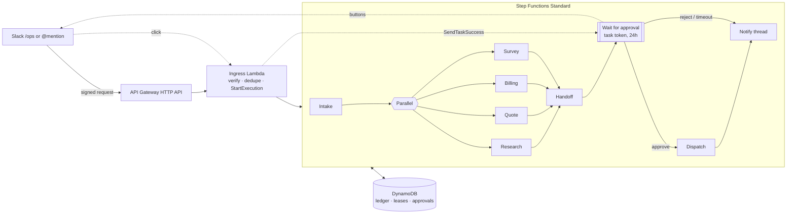

# customer-ops-agents

A Slack-triggered, AWS-deployable workflow where several Claude agents work
**in parallel** on one customer request, and a human approves before anything
reaches the customer.

```
/ops quote 20 Pro seats + onboarding for dana@acme.com, 10% off — check billing and send a survey
```

| Agent | What it does | Writes |
|---|---|---|
| **Intake** (router) | Classifies the request, extracts the customer, decides which agents to run | HubSpot contact (create-or-get) |
| **Research** | Tool-using agent: HubSpot deals, recent Gmail threads, web search → account brief | — (read-only) |
| **Quote** | Maps requested items to the Stripe price catalog, prices in code, drafts a quote | Stripe customer + **draft** quote, HubSpot deal |
| **Billing** | Invoices/subscriptions → health assessment, outstanding balance, suggested actions | — (read-only, can't move money) |
| **Survey** | Drafts a short CSAT/NPS survey, respecting a per-customer cooldown | — |
| **Customer handoff** | Merges all results (including failures) into an owner handoff + customer email | HubSpot note |
| **Dispatch** (after approval) | Finalizes the quote, emails the customer, sends the survey, creates the owner task | Stripe, Gmail, HubSpot |

## Architecture



Everything is TypeScript: agents in `src/agents`, provider clients in
`src/providers`, the state machine in `infra/stack.ts` (AWS CDK).

## Errors and race conditions — how each is handled

| Scenario | What would go wrong | Mitigation | Where |
|---|---|---|---|
| Slack retries an event (no 200 within 3 s) | Same request processed 2–4× | Execution name = `evt-<event_id>`, input byte-identical → `StartExecution` is idempotent | `ingress-core.ts` |
| User double-submits `/ops` | Two parallel runs | 60 s debounce via conditional put on `hash(user, channel, text)` | `ingress-core.ts` |
| Forged / replayed Slack request | Anyone can trigger runs or approve | HMAC signature + 5-min timestamp window, constant-time compare | `slack-verify.ts` |
| Lambda or Step Functions retries a step | Duplicate emails, quotes, tasks | Every side effect runs through `once(key)` — a DynamoDB idempotency ledger; Stripe also gets native idempotency keys | `idempotency.ts` |
| Crash after Gmail accepted, before ledger write | Email sent twice on retry | Deterministic `Message-ID` from the effect key; Sent folder checked (`rfc822msgid:`) before sending | `gmail.ts` |
| Two runs create the same Stripe customer | Duplicate customers | Per-email lease + strongly consistent `customers.list` (search lags ~1 min) + idempotency key | `quote.ts`, `lease.ts` |
| Two runs create the same HubSpot contact | Duplicate contact | HubSpot's unique email → `409 Existing ID` is adopted | `hubspot.ts` |
| Lease holder stalls past its TTL | Two holders | Lease auto-expires; release is token-conditional; fencing token + `stillHeld()` re-check | `lease.ts` |
| Two approvers click at once / double-click | Conflicting decisions, double dispatch | Conditional `PENDING → APPROVED/REJECTED` update; losers get an ephemeral "already decided" | `approval.ts` |
| Click races the 24 h timeout | Approve after expiry | `TaskTimedOut` from SendTaskSuccess → marked EXPIRED, message updated | `approval.ts` |
| Approval step retried | Old token in Slack button | Button carries only `runId`; latest token stored in DynamoDB | `approval.ts` |
| Crafted execution skips approval | Unapproved sends | Dispatch re-checks the decision in DynamoDB, not just the payload | `dispatch.ts` |
| Two runs survey the same customer | Survey spam | Atomic cooldown reservation (`survey#email`) at send time | `dispatch.ts` |
| One agent fails or a provider is down | Whole run fails | Per-branch `Catch` → `{status:"failed"}`; handoff reports the gap; others carry on | `stack.ts` |
| Partial dispatch failure | Some actions done, some not | Throw retryable → Step Functions re-runs dispatch; completed actions replay from the ledger | `dispatch.ts` |
| Rate limits (Claude / HubSpot / Stripe / Slack 429) | Bursty failures | In-process jittered backoff honoring `Retry-After`, then Step Functions retries with full jitter | `retry.ts`, `stack.ts` |
| LLM hallucinates an email, price id or total | Wrong customer, wrong price | Email must appear verbatim in the request; price ids checked against the catalog; totals and discounts computed in code | `intake.ts`, `quote.ts` |
| Discount above policy | Over-discounting | Flagged loudly on the approval card (`MAX_AUTO_DISCOUNT_PCT`) | `approval.ts` |
| Prompt injection via emails / web pages | Agent does something unintended | Untrusted text wrapped in tags and treated as data; research tools are read-only and scoped to one customer; nothing customer-facing happens without a human | `llm.ts`, `research.ts` |
| Claude refusal / truncated output | Garbage downstream | `stop_reason` checked; server-side fallback model enabled; outputs validated with Zod | `llm.ts` |
| Header injection in outbound email | Extra recipients | CR/LF stripped from headers | `gmail.ts` |

Benign race worth knowing: billing may run before quote has created the Stripe
customer and report "no billing history". That is correct for a new account, so
billing doesn't take the lock.

## Run it locally (no accounts needed)

```bash
cd customer-ops-agents
npm install
npm test                 # 22 tests: races, retries, duplicates, approvals, end-to-end
npm run local            # full workflow against fake Stripe/HubSpot/Gmail/Slack + scripted LLM
npm run local -- --reject
ANTHROPIC_API_KEY=... npm run local -- --live-llm "Quote 5 Pro seats for dana@acme.test and check billing"
```

`src/local/orchestrator.ts` mirrors the state machine's Retry/Catch semantics in
process, so the race tests run the real agent code against shared fakes.

## Deploy to AWS

Prereqs: AWS credentials, Node 22, `npx cdk bootstrap` once per account/region.

```bash
npx cdk deploy \
  -c approverUserIds=U012ABC,U034DEF \
  -c defaultOwnerId=12345678
```

1. **Secrets** — put the JSON from `.env.example` into the secret from the `SecretArn` output:
   ```bash
   aws secretsmanager put-secret-value --secret-id <SecretArn> --secret-string file://secrets.json
   ```
2. **Slack** — create an app from `slack-app-manifest.yaml`, replacing `API_BASE` with the
   `SlackRequestUrlBase` output. Install it, copy the bot token + signing secret into the
   secret, and `/invite @customer-ops` into your channel.
3. **Stripe** — a restricted key with write access to Customers, Quotes, Coupons and read
   access to Prices, Invoices, Subscriptions. Use a test-mode key first.
4. **HubSpot** — a private app token with `crm.objects.contacts.read/write`,
   `crm.objects.deals.read/write` (notes and tasks are covered by the contact/deal scopes in
   most portals; add `crm.objects.notes`/`tasks` if your portal lists them separately).
   Set `DEAL_STAGE_*` if you don't use the default pipeline.
5. **Gmail** — OAuth client + refresh token for the sending mailbox with
   `gmail.send` and `gmail.readonly`.

Then in Slack: `/ops quote 10 Pro seats for dana@acme.com and check billing`.

### What gets created

API Gateway HTTP API → ingress Lambda; a Step Functions **Standard** state machine
(exactly-once transitions, name-based dedupe, 26 h max); 9 step Lambdas (Node 22, arm64,
X-Ray); one DynamoDB table (on-demand, TTL, PITR, retained on stack delete); a Secrets
Manager secret; a CloudWatch alarm on failed executions.

## Limits and next steps

- **Slack's 3 s ack**: a cold ingress Lambda (secrets + post + StartExecution) can come
  close. If you see `operation_timeout`, add provisioned concurrency to `SlackIngressFn`.
- **Step Functions payloads are capped at 256 KB**; agents return summaries and ids, not
  raw provider data. Move big artifacts to S3 if you extend them.
- **Survey cooldown** is reserved before sending; if dispatch exhausts its retries mid-send,
  the reservation stays until it expires.
- **HubSpot has no compare-and-swap**: concurrent edits by humans to the same deal are last-write-wins.
- Ideas: a Stripe `quote.accepted` webhook to trigger the survey, a Step Functions
  Distributed Map to batch-process a CSV of accounts, per-agent reserved concurrency to protect
  HubSpot's 100 req/10 s limit.
