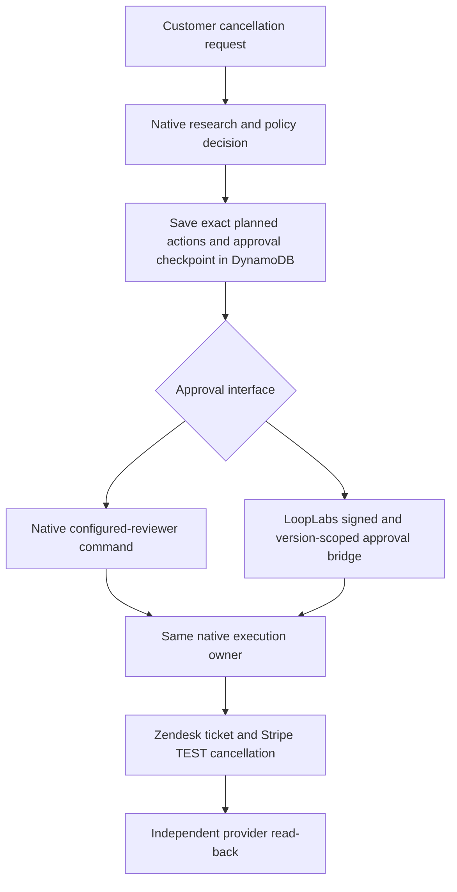

# Native approvals and LoopLabs: a bounded cancellation comparison

Measured October 29, 2026 (Pacific). This is a partial native demonstration,
not acceptance of a prospect's application or a LangGraph integration.

## Business purpose

Acme Customer Experience wants to cancel a subscription inside its twelve-month
commitment. The policy requires an authorized exception. Compare the existing
application with native approval against the same application with its existing
LoopLabs shared-approval bridge. Native approval remains enabled in both modes.

Owner: Raj. Department: Customer Experience. Team: cx-retention.
Execution owner: the existing Acme TypeScript workflow kit. The four declared
roles are ticket-context, policy-research, gift-card-desk and case-decision;
the measured comparison used deterministic drafting, with no LLM invocation.

The current policy is `acme-cxl-2026-10` in
[product-cancellation.ts](../acme-ops/src/workflows/product-cancellation.ts).
Product commitment/refund eligibility comes from Stripe product metadata.
This does not establish arbitrary policy injection through LoopLabs.

## Reuse decision and actual deployment

Reuse the native workflow, provider clients, DynamoDB checkpoints and approval
bridge. No second workflow engine, dispatch queue, approval database or telemetry
service was implemented. Configuration-only deployment is necessary for a real
native-only baseline: calling the native decision API on the controlled runtime
would not establish that LoopLabs was absent.

| Mode | AgentCore runtime version | Application source | Configuration |
| --- | --- | --- | --- |
| Native approval baseline | 1 | `3300101ed35225832246897ed2bd2a24894a6bff` | `acme-cancellation-comparison-native-1.0`; bridge configuration absent, signing-key override empty |
| Existing LoopLabs-connected cancellation | 5 | `3300101ed35225832246897ed2bd2a24894a6bff` | `acme-cancellation-1.2.1-3300101`; existing reviewed bridge configuration retained |

Both use the exact same existing container artifact. The original runtime,
reviewer configuration, secret and IAM role were not changed. The IAM-only
baseline reuses the same Acme DynamoDB table and TEST-provider account bindings.
That reuse is explicitly **not separate-business isolation proof**. Existing
privileged native decision access remains; this is not a universal gateway that
prevents every alternate authorized execution path.



## What the fresh native test actually measured

Two new Stripe TEST trial subscriptions used twelve-month commitment metadata
and explicitly disabled refundable terms. No real payment or refund was issued.
The request arrived by an authenticated IAM invocation, with `channel: phone`;
this is not fresh Slack/email intake acceptance. Customer notifications were
directed only to the owner's existing demo bindings.

| Check | Observed result |
| --- | --- |
| Both requests reach an approval hold | Both native and DynamoDB read-back reported `AWAITING_APPROVAL`; Stripe still reported `trialing` |
| Native reviewer not in the configured allowlist | Refused: application HTTP 403, transported by AgentCore as `RuntimeClientError` |
| Bad LoopLabs signature | Refused: 401 |
| Wrong deployment version | Refused: 409 |
| Wrong tenant scope | Refused: 409; this one boundary test is not full tenant-isolation acceptance |
| Stale exact-request revision | Refused: 409 |
| Native approval and final cancellation | Automated TEST decision saved, but execution was **partial**; Stripe remained `trialing` |
| Full LoopLabs approval-to-provider completion | Not completed; the fresh case remains held because the provider prerequisite failed |
| Current browser approval experience | Unmeasured: browser signed out and owner away from laptop |
| Fresh restart/crash, recovery and effect replay on AWS | Unmeasured; new sessions reading DynamoDB do not establish a killed-worker recovery test |

### Exact provider failure and next action

Zendesk's OAuth endpoint returned HTTP 302 with `Location:
/agent/expired-trial`. Following the redirect produced HTML rather than a token.
The deployed client surfaced a JSON parsing error. Ticket creation and dependent
actions failed; the native run reported `DONE` with `outcome: partial`, **not a
successful cancellation**. The independent Stripe read-back confirmed that no
cancellation occurred. Do not count `DONE`, HTTP success, or approval submission
as final business correctness.

The local diagnostic patch in
[zendesk-oauth.ts](../acme-ops/src/providers/zendesk-oauth.ts) refuses redirects,
classifies the known same-origin expired-trial path and redacts malformed token
responses. Its two new failure cases reproduced before the patch and pass after
it. This diagnostic patch is **not deployed** and does not reactivate Zendesk.

Account reactivation is required before a fresh final-provider test. Do not buy a
plan, change terms, substitute a twin, bypass the policy or manually cancel the
subscription to manufacture a successful application receipt. Once reactivated:

1. Recheck OAuth and the exact runtime/source bindings.
2. Resume the saved failed actions under the existing native recovery contract;
   inspect current approval expiry and saved action references first.
3. Use a valid current review for the held LoopLabs request, then execute only
   through the existing native owner.
4. Independently read both Stripe subscriptions and Zendesk tickets; require the
   declared actions to succeed, not merely the run to reach `DONE`.
5. Replay the same decisions and compare action attempts, provider references and
   provider state. Keep this receipt separate from historical October 19 proof.

## Local checks and their scope

Run from `acme-ops`:

```sh
npm run check
npm test
npm run bundle
```

The initial selected suite passed 51 tests. Adding the same-application
comparison added 11 tests; the full Acme suite then passed 360 tests. The two
Zendesk diagnostic regressions failed before the patch and passed after it;
the final full suite passed 362 tests with no skipped tests. Type checking and
bundling also passed. These are local checks, not a FetchSandbox MCP receipt or
native LangGraph acceptance.

[Comparison tests](../acme-ops/test/cancellation-control-comparison.test.ts)
use the actual cancellation definition and provider clients against the existing
local HTTP fixture. They exercise holds, rejected reviewers, rejection, an
engine/store reconstruction from a saved file, one provider cancellation across
decision replay, and stale/mismatched external reviews. FileStore reconstruction
is not a process-SIGKILL test. No new telemetry pipeline was added: the original
native producer keeps its minimized saved business events; the baseline without
the adapter has no LoopLabs control checkpoint. Source-reported events do not
establish provider truth.

## Prospect fit: use the right story

The public discussion is
[Building Master Agent](https://www.reddit.com/r/AI_Agents/comments/1xga6hz/).
The complete signed-in thread included later replies omitted by the initial
public excerpt. The author **reports** a separate payment-key service called
Vault running in practice mode, a signed exact-payment approval record, per-
business caps and an independent review. We have not inspected his code,
identity ceremony, keys or review report.

His latest named first workflow is **ad creative for a pergola company, then
owner approval, then publishing**. An older comment proposed inquiry-to-quote.
Do not call our cancellation workflow a replica of either application. His
LangGraph/Postgres/LiteLLM choices and some authority/recovery changes are
self-reported designs, not our independent acceptance results.

The strongest prospective proof is accepted publication followed by a lost
response or worker crash. Approval consumption in a local transaction does not
atomically commit a remote platform send. A transactional outbox records durable
intent; it does not itself guarantee one external publication. Provider-supported
idempotency and authoritative lookup, or containment of an unknown outcome, are
required. Preserve his Vault and execution owner rather than adding another
executor for the same post.

Before building that platform adapter, establish the actual destination API,
practice-mode scope, exact creative/version/target approval contract, lookup and
idempotency behavior, and independent observation path. Required cases include
normal approval; edited creative after approval; wrong business; expired/revoked
authority; crash before send; accepted response loss; crash after effect; and
retry with an unknown outcome. Device-bound human approval, KMS/HSM key custody,
delegation laundering and production budget enforcement remain separate gates.

No ad-platform adapter, live campaign, paid publication, LangGraph adapter or
device-bound approval implementation was built or deployed by this comparison.
