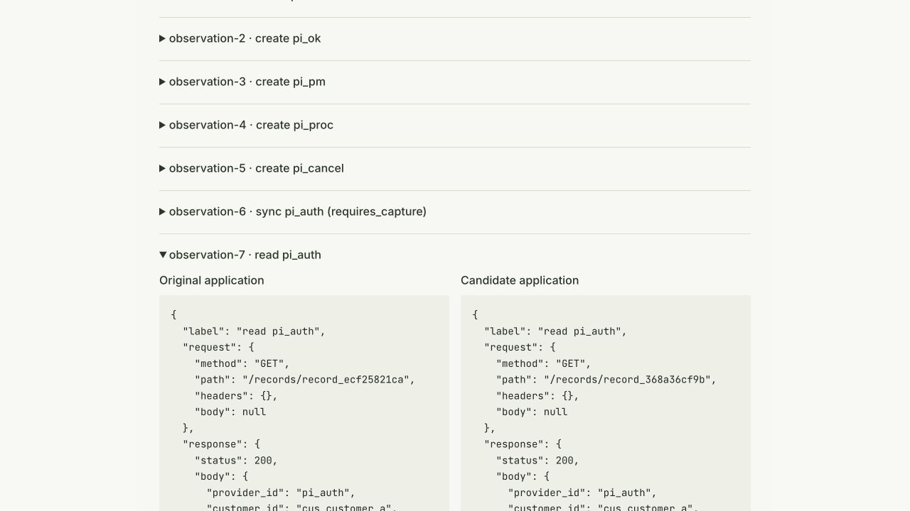

# Stripe docs workflow probe checks, October 10, 2026

This report follows twenty named public Stripe guides and twenty runnable
consumer-state applications. It checks whether the deployed generated-probe
engine can reproduce each planted business-rule bug and verify its candidate
patch on the running application. It does not claim every guide endpoint or
production invariant is covered.

The provider runtime baseline separately executed **21 request workflows,
21 passed, 0 failed**, through published `fetchsandbox-mcp@0.7.11` against
`https://fetchsandbox.com`. That is twin request-workflow evidence, not proof
of these customer applications or full live Stripe parity.

## Application results

Each completed row was independently retrieved from its stored snapshot. A
verified row requires a measured verdict, execution of both versions, exit
code **1 → 0**, nonempty request records on both sides, and an HTTP 200 receipt.
The underlying execution used generated recording doubles. It did not measure
Stripe browser checkout, production network delivery, complete nested provider
schemas, or live provider behavior. SQL counts below refer to emitted SQLite
trace lines, not invented database telemetry.

| Public guide | Bounded app rule | Before / after observations | Evidence |
|---|---|---|---|
| Accept a Payment with PaymentIntents | Recorded rule verified | 33 / 33 | [receipt](https://fetchsandbox.com/runs/fix-f386333b21e2?flow=cc2db145eadf) |
| Accept Payment via Checkout Session | Recorded rule verified | 21 / 21 | [receipt](https://fetchsandbox.com/runs/fix-ec975b51a3c3?flow=f59f40f392dc) |
| Create and Manage a Recurring Subscription | Recorded rule verified | 22 / 22 | [receipt](https://fetchsandbox.com/runs/fix-727548100814?flow=1c803d7f9759) |
| Refund a Payment | Recorded rule verified | 12 / 12 | [receipt](https://fetchsandbox.com/runs/fix-77a53ee996d7?flow=59870fa0a3dc) |
| Save a Payment Method for Future Use (SetupIntent) | Recorded rule verified | 17 / 17 | [receipt](https://fetchsandbox.com/runs/fix-f28f86490c8d?flow=dcc2c81e7365) |
| Create and Send an Invoice | Recorded rule verified | 17 / 17 | [receipt](https://fetchsandbox.com/runs/fix-682fc73c28f4?flow=7513c7139df6) |
| Onboard a Connected Account (Stripe Connect) | Recorded rule verified | 17 / 17 | [receipt](https://fetchsandbox.com/runs/fix-f4db08545d8c?flow=7f2a0b93b9b0) |
| Transfer Funds to Connected Account and Payout | Recorded rule verified | 20 / 20 | [receipt](https://fetchsandbox.com/runs/fix-fe8777e6015f?flow=d2a36935990e) |
| Handle a Payment Dispute (Chargeback) | Recorded rule verified | 9 / 9 | [receipt](https://fetchsandbox.com/runs/fix-a67f71ae85b8?flow=dfbfdd0d3267) |
| Set Up Product Catalog with Prices | Recorded rule verified | 17 / 17 | [receipt](https://fetchsandbox.com/runs/fix-eb9098c99808?flow=f958e94ff397) |
| Create a No-Code Payment Link | Recorded rule verified | 17 / 17 | [receipt](https://fetchsandbox.com/runs/fix-2ac1b0db0331?flow=7c92dda1fb6b) |
| Set Up Webhook Endpoints for Event Handling | Recorded rule verified | 22 / 22 | [receipt](https://fetchsandbox.com/runs/fix-b136a696922b?flow=3aaf2b7d9175) |
| Create Coupons and Promotion Codes | Recorded rule verified | 17 / 17 | [receipt](https://fetchsandbox.com/runs/fix-3981ccbaea40?flow=de20cb26f179) |
| Schedule Subscription Changes | Recorded rule verified | 17 / 17 | [receipt](https://fetchsandbox.com/runs/fix-d254fe1ac3c9?flow=b98b876ea610) |
| Issue Virtual Cards (Stripe Issuing) | Recorded rule verified | 17 / 17 | [receipt](https://fetchsandbox.com/runs/fix-61c35adbc18c?flow=2daf28b39e86) |
| Verify Customer Identity (Stripe Identity) | Recorded rule verified | 20 / 20 | [receipt](https://fetchsandbox.com/runs/fix-220775a55c38?flow=899817a7fcb3) |
| Accept In-Person Payment (Stripe Terminal) | Recorded rule verified | 20 / 20 | [receipt](https://fetchsandbox.com/runs/fix-8b618f528d53?flow=db7395a8f3ca) |
| Set Up Treasury Financial Account | Recorded rule verified | 17 / 17 | [receipt](https://fetchsandbox.com/runs/fix-a759d458135b?flow=e8417aec89f1) |
| Customer Self-Service Billing Portal | Recorded rule verified | 8 / 8 | [receipt](https://fetchsandbox.com/runs/fix-3f4b7098bc83?flow=d77987668c57) |
| Create a Quote and Convert to Subscription | Recorded rule verified | 20 / 20 | [receipt](https://fetchsandbox.com/runs/fix-b365d3bdb3d9?flow=1866d8ce8027) |

[Machine-readable scope and observations](coverage.json)

## What the receipt shows

It distinguishes the original assertion failure from the candidate's result.
Each observation expands to the recorded request and response on both sides.
The rule, application logs, exact diff and declared provider modes are visible.
An HTTP 200 is not presented as a business-rule pass.

## Distribution and client checks

The production engine and receipt renderer fixes were deployed before this
batch. The client candidate adds a bounded response and `get_job` continuation
for the existing backend jobs, plus excludes credential-bearing MCP configs
from project uploads. Its npm release is blocked: the supplied publishing token
returns 401. Do not treat `0.7.12` as available from npm yet.

Native Claude Code, Codex and Cursor checks are recorded separately from the
SDK controls. A completed application receipt does not establish that an
agent conversation or its unchanged assertion gate passed. Codex and Cursor each received measured own-code Stripe proofs through their
actual CLI clients. Their unchanged debug assertion contracts each scored
11/12 because they exclude `quickrun`, which current tool guidance recommends.
Those gates remain failed. Claude's earlier runs ended without receiving a
completed measured proof; later completed jobs do not retroactively pass a
conversation. Fresh post-release checks are in progress.

[Native client assertion results](native-client-checks.json) remain separate
from the twenty SDK application controls. The native Stripe prompt is primed;
it does not establish unprimed tool discovery. An unchanged unprimed persona is
also recorded against a Paddle/Resend fixture, not silently relabelled Stripe.

## False-green controls

Three candidate patches changed only an application title, leaving its planted
bug in place. The production engine rejected all three as `fix_incomplete`,
with original and candidate assertion exits **1 → 1** and nonempty evidence.
These controls cover PaymentIntent, refunds and billing portal boundaries.
[Measured negative controls](negative-controls.json).

## Follow-up production release

Backend `2566c09efa02f5210488556d9bfcf4cf128a8296` and hosted MCP
`b7438ad5` were deployed after the twenty-application batch. This repair binds
jobs to their initiating account, preserves active jobs under retention and
capacity pressure, reports observed elapsed time, and bounds complete HTTP
reads without resubmitting ambiguous starts. A two-account production control
confirmed owner reads return 200 and a different account receives 403.
This is auth evidence, not an application proof. Jobs are still in-process and
do not survive a backend restart.

No live Stripe payments or messages were sent. Each test used a disposable
FetchSandbox account/key and records its independently confirmed revocation.
Private transcripts and credential-bearing configurations are not published.
